<div align="center">

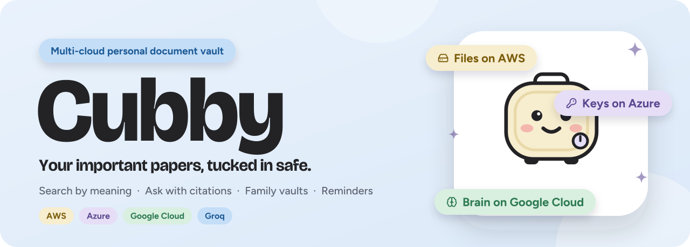

<br/>

**A private vault for your most important papers: passports, insurance, bills, marksheets.**<br/>
**Search them by meaning, ask them questions with page-level citations, share them with family,<br/>and get reminded before anything expires. Built on three clouds so no single company can ever read them.**

<br/>

[](https://cubby-511102.web.app)
[](docs/UPGRADE_v1.3.md)


<br/>


<br/>

[**The problem**](#-the-problem) · [**Features**](#-features) · [**How it works**](#%EF%B8%8F-how-it-works) · [**Cloud architecture**](#%EF%B8%8F-cloud-architecture) · [**Security**](#%EF%B8%8F-security-model) · [**Tech stack**](#-tech-stack) · [**Run it**](#-run-it-locally) · [**Deploy**](#-deploy-to-the-cloud) · [**Roadmap**](#%EF%B8%8F-roadmap)

<br/>


<sub>A 20-second tour: Overview → Documents → Family → Studio → Trust Center.</sub>

</div>

<br/>

## 😩 The problem

Everyone has a pile of papers that matter: a passport, an Aadhaar and PAN card, insurance policies, a rent agreement, marksheets, medical reports, warranties. Today they live in a mess of email attachments, WhatsApp chats, phone galleries and a drawer at home.

| What goes wrong | Why it hurts |
| :--- | :--- |
| 🗂️ **Scattered everywhere** | Finding "the latest health policy" means scrolling through three apps and a family group chat. |
| 🔎 **You can't search what's inside** | Search works on file names, and scans are called `IMG_2041.jpg`. Nobody remembers which PDF holds the deductible. |
| ⏰ **Deadlines slip by** | Passports, policies and agreements expire quietly. You find out at the airport or the hospital desk. |
| 👨‍👩‍👧 **Families share badly** | "Can you send me Papa's PAN again?" ends up in a chat app, unencrypted and forever. |
| 🤖 **AI tools want your raw data** | Most "chat with your PDFs" apps send everything, ID numbers included, to one company's servers. |
| ☁️ **One cloud holds everything** | Usual cloud storage keeps your files and their encryption keys with the same provider. One breach or one bad config exposes it all. |

## 💡 The idea

**Cubby is a personal document vault that is genuinely useful (search, answers, reminders, family sharing) without asking you to trust any single company.**

<table>
<tr>
<td width="33%" valign="top">

### 🔐 Private by design
Every file is encrypted before it's stored. Your files, your data key and the master key live with **three different cloud providers**, so a breach at any one of them finds only locked boxes.

</td>
<td width="33%" valign="top">

### 🧠 Actually smart
Cubby reads each document, files it on the right shelf, finds the important dates, recognises ID cards, and answers questions **with citations that open the exact page**, passage highlighted.

</td>
<td width="33%" valign="top">

### 👪 Made for households
**Family vaults** work like a WhatsApp group for paperwork: share documents as cards, request the one you need with a tap, and ask `@Cubby` about anything the family has shared.

</td>
</tr>
</table>

<br/>

## ✨ Features

### 💬 Ask your documents, get answers with receipts


Ask in plain English, such as *"What does my health insurance cover, and when does it renew?"*. Cubby finds the right passages using vector search, writes the answer live, and cites every fact. Click a number and the document slides in **at that page with the passage highlighted**. If Gemini is down, Groq answers instead, automatically.

### 👪 Family vaults: a group chat for your household's paperwork


- **Share documents as cards** that everyone can open or save to their own vault.
- **Request a document** ("Car insurance, please, for the service centre") with a one-tap **Share it** button for the person asked.
- **`@Cubby` in the group** answers *only* from documents shared in that family, with sources.
- **Shared reminders**: an expiry in a shared document reminds every member.
- **Its own encryption key per family.** Sharing makes a separate encrypted copy, and full ID numbers never enter a family (only `••••234K`).
- Read receipts, replies, unread badges, roles (admin/member), invites by email.

### 🪪 Drop a file in, Cubby does the filing


Upload a PDF, photo or text file and Cubby **encrypts it immediately**, reads it (OCR for scans), picks a shelf, writes a summary, finds expiry and renewal dates, and recognises IDs. Aadhaar numbers are checked with the **Verhoeff checksum**, PAN by format, and passports by their **machine-readable zone check digits**. Renewed IDs automatically replace older copies.

<br/>

### 📸 Screens

<table>
<tr>
<td width="50%">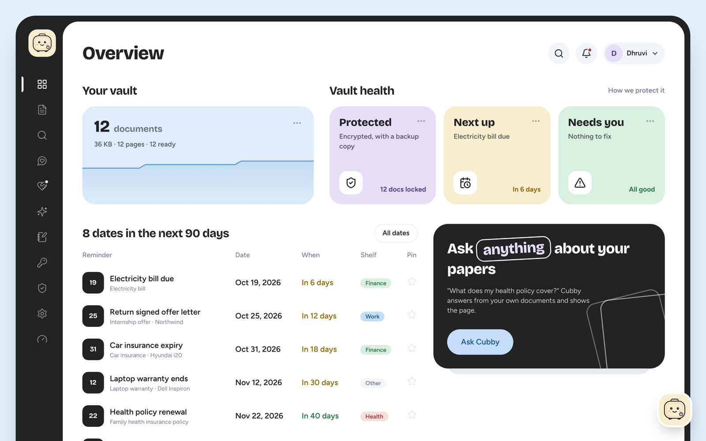<p align="center"><b>Overview</b>: vault health, what's coming up, quick ask</p></td>
<td width="50%">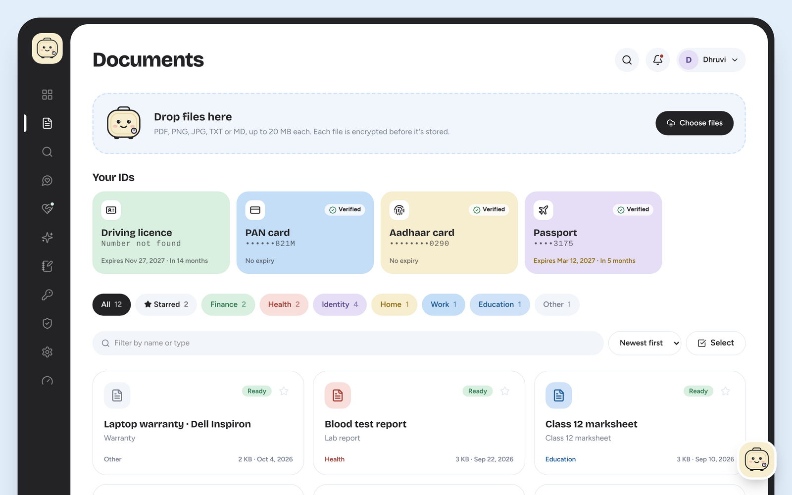<p align="center"><b>Documents</b>: ID cards, shelves, filters, bulk actions</p></td>
</tr>
<tr>
<td>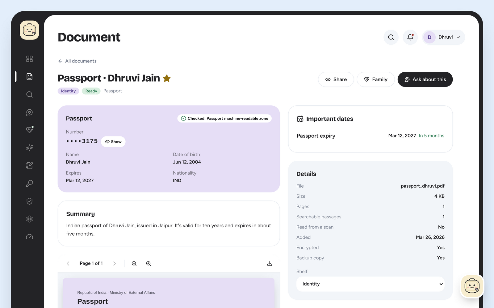<p align="center"><b>ID details</b>: masked number, checksum-verified, password to reveal</p></td>
<td>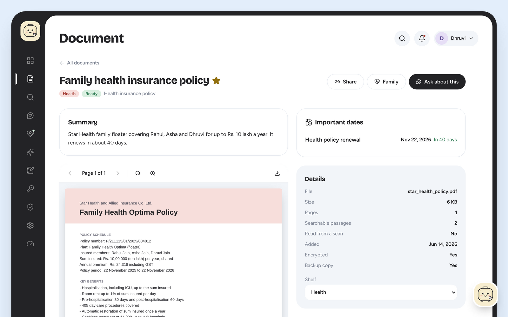<p align="center"><b>Document</b>: summary, key dates, in-app viewer</p></td>
</tr>
<tr>
<td>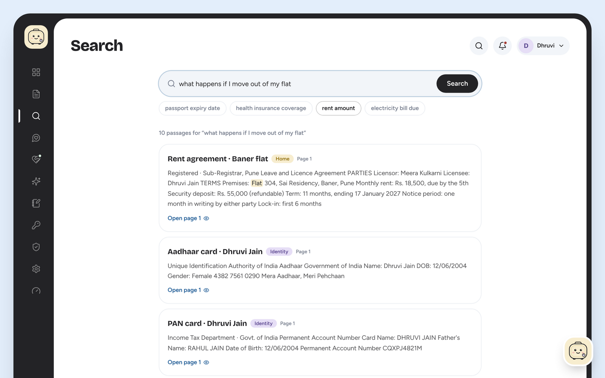<p align="center"><b>Search by meaning</b>: finds passages, not file names</p></td>
<td>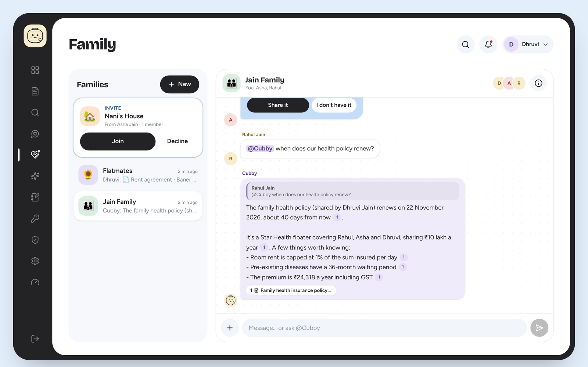<p align="center"><b>Family</b>: requests, shared cards, @Cubby</p></td>
</tr>
<tr>
<td>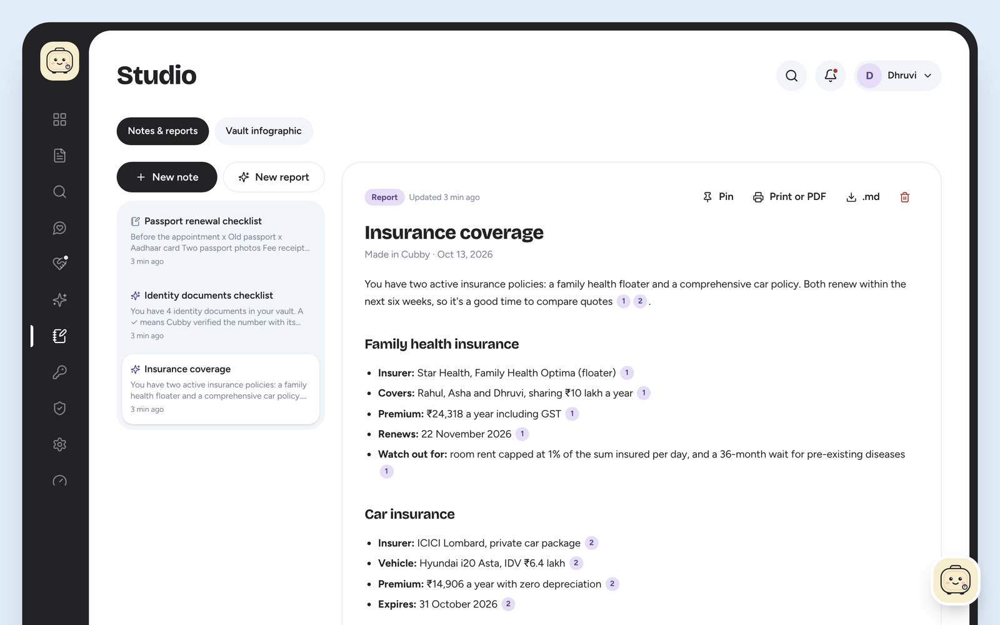<p align="center"><b>Studio reports</b>: cited, printable, exportable</p></td>
<td>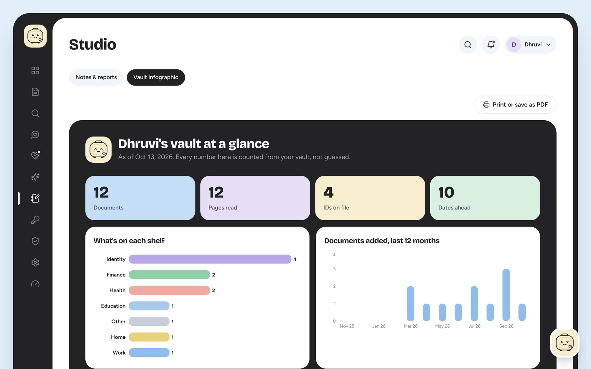<p align="center"><b>Vault infographic</b>: exact numbers, no AI guessing</p></td>
</tr>
<tr>
<td>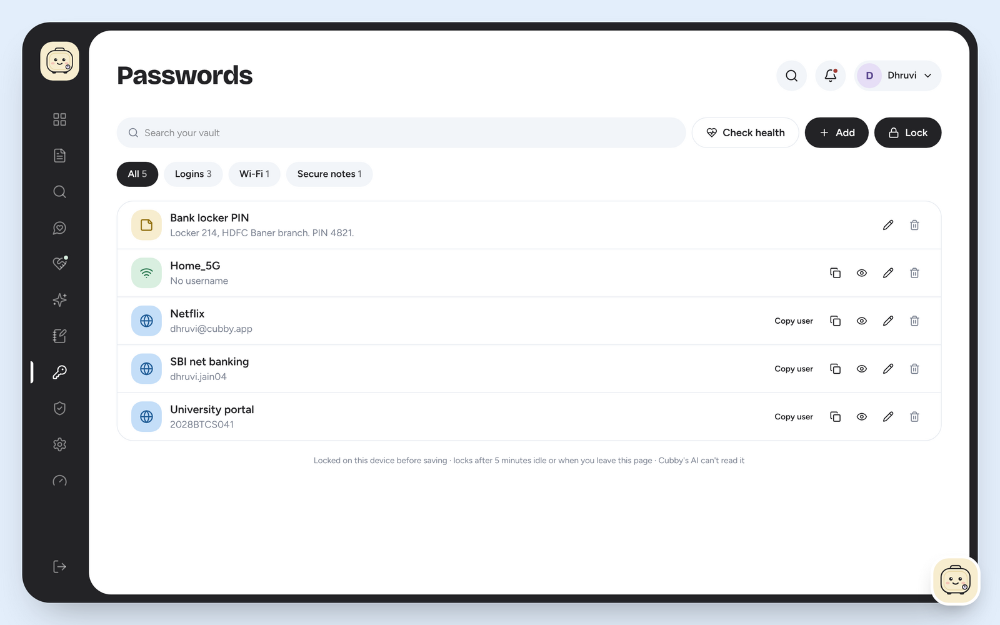<p align="center"><b>Password vault</b>: encrypted in your browser</p></td>
<td>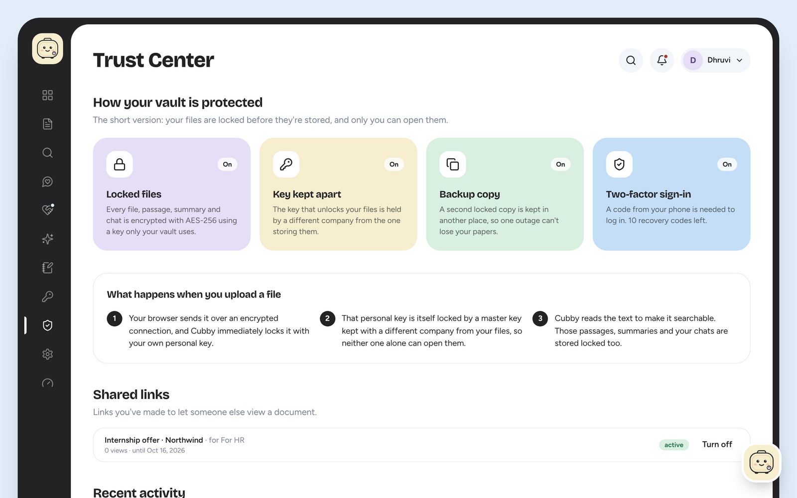<p align="center"><b>Trust Center</b>: how you're protected, links, activity</p></td>
</tr>
<tr>
<td>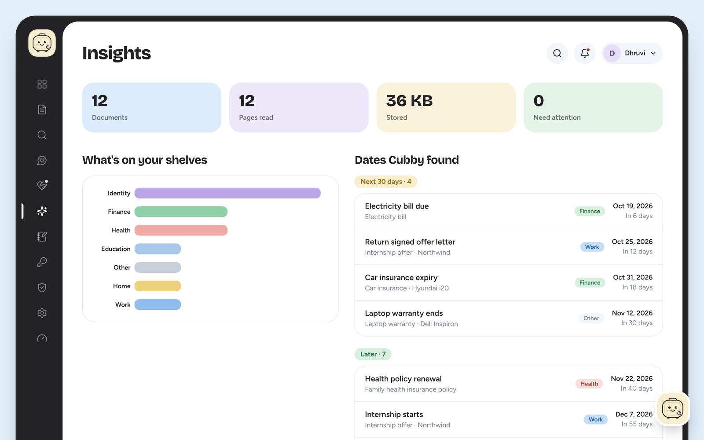<p align="center"><b>Insights</b>: shelves and every date Cubby found</p></td>
<td>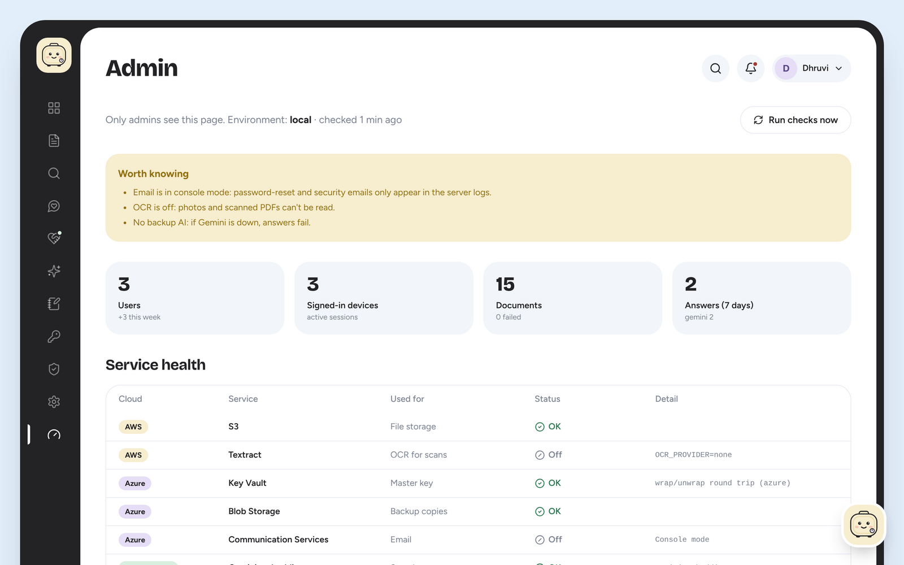<p align="center"><b>Admin</b>: live health checks for every cloud service</p></td>
</tr>
</table>

<div align="center">
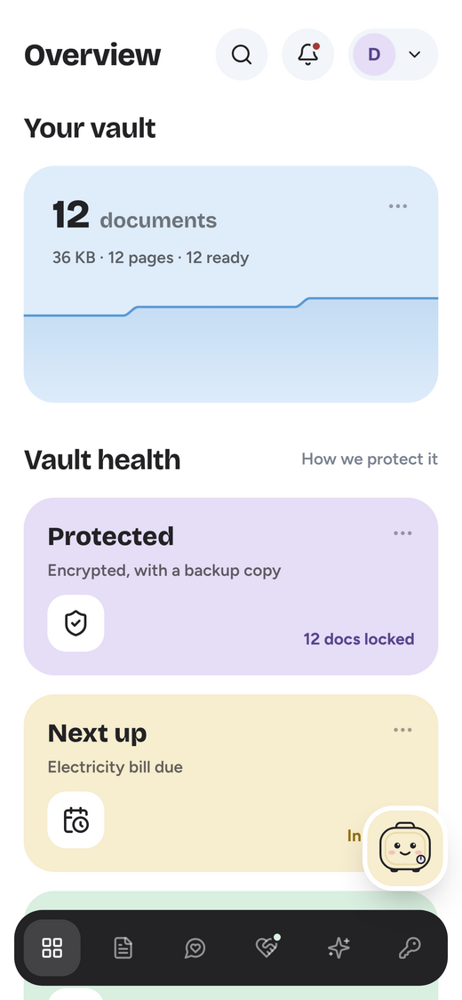&nbsp;
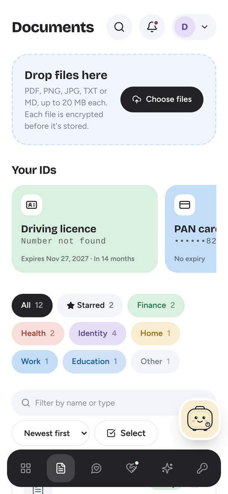&nbsp;
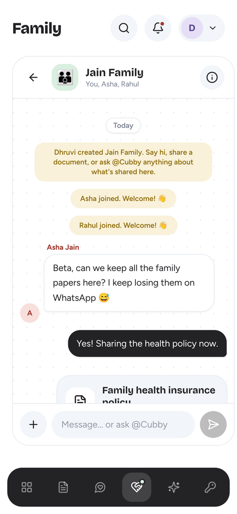&nbsp;
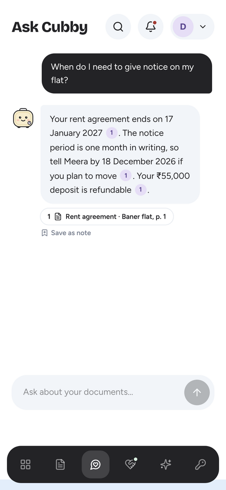
<br/><sub>Fully responsive, with a bottom tab bar on phones.</sub>
</div>

<br/>

### 🧾 Everything Cubby does

<details open>
<summary><b>📁 Vault and organising</b></summary>

- Encrypted uploads (PDF, PNG, JPG, TXT, MD, up to 20 MB) with a **backup copy on a second cloud**
- File-type checks on the actual bytes (a renamed `.exe` is rejected), duplicate detection by content hash
- OCR for photos and scanned PDFs via **AWS Textract**, used only when a PDF has no text layer
- Automatic shelves: Finance, Health, Identity, Home, Work, Legal, Education, Other
- AI title and summary, plus expiry, renewal and due dates pulled from the text
- *"Is this right?"*: when Cubby isn't confident about a document's type, it asks instead of guessing
- Star, sort, filter, multi-select to move, star or delete
- Reprocess any document; old ID versions are kept but marked as replaced
</details>

<details>
<summary><b>🪪 ID cards</b></summary>

- Passport, Aadhaar, PAN, driving licence and voter ID recognised and shown as cards, grouped by person
- **Numbers are found locally with exact rules and never sent to the AI**
  - Aadhaar: 12 digits plus the Verhoeff checksum, ignoring numbers that sit inside dates
  - PAN: `AAAAA9999A` with a valid holder-type letter
  - Passport: ICAO 9303 TD3 machine-readable zone with check digits, falling back to the printed number
- Masked by default (`••••3175`). **Show** needs your account password and hides the number again after 30 seconds
</details>

<details>
<summary><b>💬 Ask, search and Studio</b></summary>

- **Semantic search** over 768-dimension Gemini embeddings in pgvector (HNSW), with a small keyword boost
- **Streaming chat** (NDJSON) with numbered citations → in-app PDF viewer opens at the page and highlights the passage
- A floating Cubby on every page; on a document page it only answers about that document
- **Privacy shield**: long digit runs, PAN, passport numbers and MRZ lines are masked to `XXXX1234` before any text reaches an AI
- **Studio**: Markdown notes with autosave, plus reports
  - *Document summary*, *Insurance coverage* and *Ask for a report* are written by AI with citations
  - *Identity checklist* and *Year ahead* are built straight from your data, so the numbers are exact
- A printable **vault infographic**; print or save any report as a PDF, or download it as `.md`
</details>

<details>
<summary><b>👪 Family vaults</b></summary>

- Up to 5 families per person, 12 people per family; invites by email (14 days), shown in-app and sent by email
- Chat with replies, read receipts ("Seen by everyone"), unread counts and a dot on the nav icon
- Document cards: open in the viewer, **Save to my vault** (re-read with your own key), remove (sharer or admin)
- Document requests with **Share it** / **I don't have it**, plus notifications both ways
- `@Cubby` answers from the family's shared documents only, never from anyone's personal vault
- Shared reminders for every member at 90, 30, 7 and 1 days
- Admins can rename, promote, remove and delete; if the last admin leaves, the next member is promoted
</details>

<details>
<summary><b>🔑 Password vault</b></summary>

- **Zero-knowledge**: a separate vault passphrase → PBKDF2-SHA256 (600,000 iterations) → AES-GCM, all in the browser via WebCrypto
- The server only stores scrambled blobs; the AI can never read them
- Logins, Wi-Fi and secure notes; a generator, a strength meter, and a clipboard that clears after 30 seconds
- **Check health**: weak, reused and breached passwords. The breach check uses Have I Been Pwned **k-anonymity** (only 5 characters of a SHA-1 hash leave the browser)
- Locks after 5 minutes idle or when you leave the page
</details>

<details>
<summary><b>🔔 Reminders, sharing and account safety</b></summary>

- Vault Pulse: in-app notifications and a **daily email digest** at 90, 30, 7 and 1 days before each date (Cloud Scheduler → `/api/internal/pulse`)
- **Share links** for one document: 1 hour to 30 days, optional view limit, download on/off, revocable, with an alert when opened
- **Mandatory TOTP two-factor** with 10 one-time recovery codes
- Argon2 password hashing, account lock for 15 minutes after 5 failed attempts, rate limits on every sensitive route
- Revocable sessions (see and sign out other devices), new-device alert emails, auto-lock after 15 minutes idle
- Password reset by email, a Trust Center with your activity log, a full export (ZIP), and *delete my vault*
- An admin page with live health checks for every cloud service and friendly error reference codes
</details>

<br/>

## ⚙️ How it works

### When you upload a file

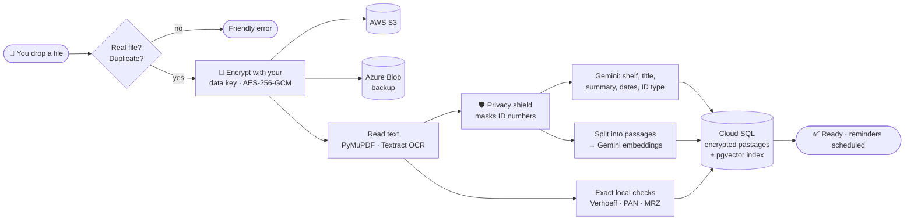

### When you ask a question (RAG)

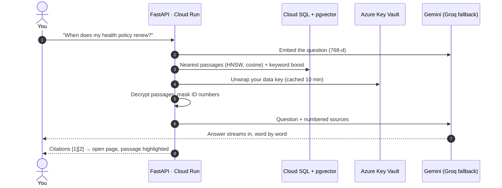

### How the encryption fits together (envelope encryption)

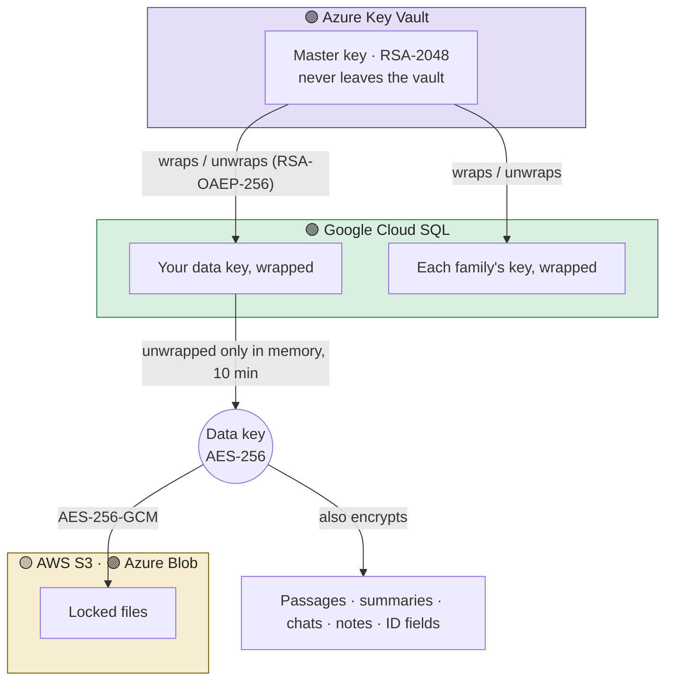

> Rotating the master key only means re-wrapping small keys, not re-encrypting every file.

<br/>

## ☁️ Cloud architecture

<div align="center">
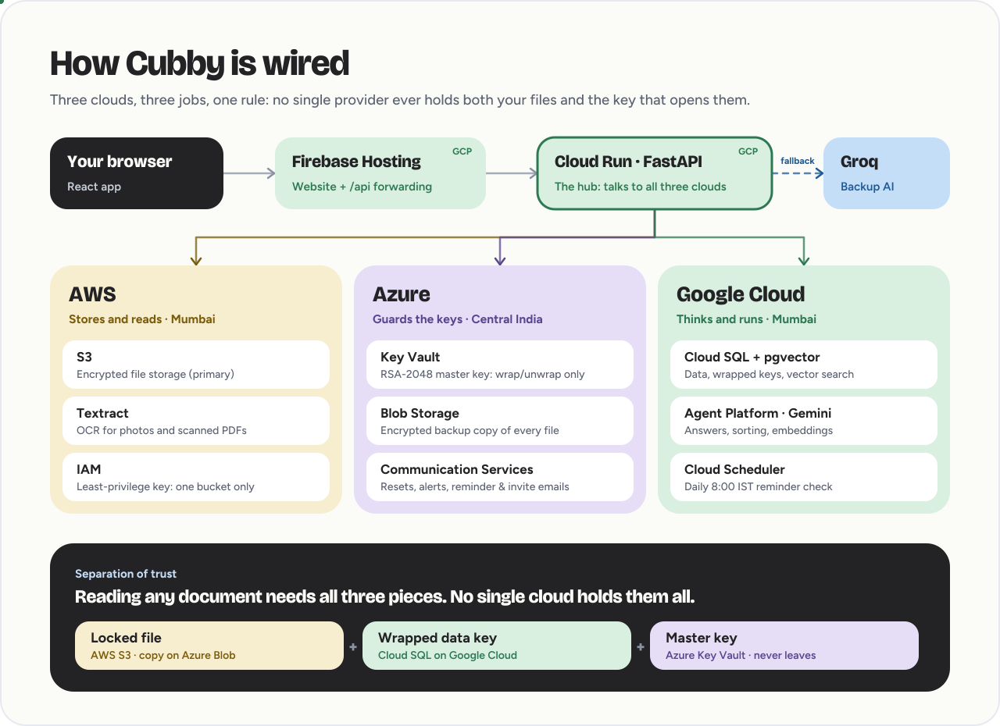
</div>

The design follows one rule: **no single provider ever holds both your files and the key that opens them.** So each cloud gets one job.

### 🟡 AWS: stores and reads · `ap-south-1` Mumbai

| Service | Its job in Cubby | Why this service |
| :--- | :--- | :--- |
| **S3** | Holds every locked file, with server-side encryption added on top | Very durable and cheap; the access key only reaches one bucket |
| **Textract** | Reads text from photos and scanned pages, page by page | Accurate OCR with no model to host; only used when a PDF has no text layer |
| **IAM user + policy** | Allows `Put`/`Get`/`Delete` on one bucket, plus text detection | Least privilege: a leaked key can't touch anything else |

### 🟣 Azure: guards the keys · Central India

| Service | Its job in Cubby | Why this service |
| :--- | :--- | :--- |
| **Key Vault** | Holds the RSA-2048 master key that wraps every data key | The key can't be exported; the *Crypto User* role can only wrap and unwrap |
| **Blob Storage** | A second locked copy of every file | A different provider: if S3 fails, Cubby reads from here automatically |
| **Communication Services** | Password resets, sign-in alerts, reminder digests, family invites | A free Azure email domain, with no mail server to run |
| **Entra ID app** | The backend's identity in Azure | One client secret, scoped to exactly these roles |

### 🟢 Google Cloud: thinks and runs · `asia-south1` Mumbai

| Service | Its job in Cubby | Why this service |
| :--- | :--- | :--- |
| **Cloud Run** | Runs the FastAPI container | Scales 0→3, pay per use; CPU stays on so uploads finish processing in the background |
| **Cloud SQL** (PostgreSQL 16 + pgvector) | Accounts, metadata, wrapped keys, encrypted passages and their vectors | One database for data *and* vector search; an HNSW index keeps it fast |
| **Firebase Hosting** | Serves the React site and forwards `/api` to Cloud Run | Global CDN and HTTPS; one origin keeps the `httpOnly` session cookie simple and safe |
| **Agent Platform · Gemini 3.5 Flash** | Answers, sorting, summaries, dates, ID fields, `@Cubby` | Fast and streams; signs in as the service account, so no API keys live in code |
| **Gemini Embedding 2** | 768-number vectors for every passage and question | One fixed model keeps every vector comparable |
| **Cloud Scheduler** | Calls the reminder check daily at 8:00 IST | Managed cron; the endpoint is protected by a secret header |
| **Cloud Build + Artifact Registry** | Builds and stores the backend image | Deploy from source with one command |

**🔵 Groq** (`openai/gpt-oss-120b`) is the automatic fallback. If Gemini fails before answering, Groq takes over, and one setting swaps which one is primary.

### 🧩 What a breach at one provider would find

| If this cloud is breached | The attacker finds | Still missing, so nothing opens |
| :--- | :--- | :--- |
| **AWS** | Encrypted files only | The data key (Google Cloud) and the master key (Azure) |
| **Azure** | Backup copies, and a master key that can't be exported | The wrapped data keys (Google Cloud) |
| **Google Cloud** | Wrapped data keys and encrypted passages | The master key (Azure) |

> **Honest limit:** the running backend holds credentials for all three clouds, so this protects against a breach *at one provider*, not a compromise of the application server itself. Moving file encryption into the browser is on the roadmap.

### ⚖️ Why three clouds, and what it costs

| ✅ What we gain | ⚠️ What it costs → how Cubby handles it |
| :--- | :--- |
| **Breach isolation**: one cloud can't open anything | **More moving parts** → a startup check names any missing setting |
| **Resilience**: files on two providers, two AI options | **Cross-cloud latency** → unwrapped keys cached in memory for 10 minutes |
| **Best tool per job**: S3, Key Vault, Gemini | **More credentials** → least privilege in every cloud |
| **No lock-in**: every service sits behind a swappable provider class | **Harder monitoring** → an admin page health-checks all three clouds |

<br/>

## 🛡️ Security model

| Layer | Protection |
| :--- | :--- |
| **Files at rest** | AES-256-GCM with a per-person key, plus S3 server-side encryption on top; a backup on a second provider |
| **Keys** | Envelope encryption; master key in Azure Key Vault (RSA-OAEP-256 wrap); data keys only ever unwrapped in memory (10 min cache) |
| **Database** | Passages, summaries, chat messages, notes, family messages and ID fields are all encrypted with the data key |
| **AI calls** | The privacy shield masks ID and account numbers to `XXXX1234` before any text leaves for Gemini or Groq; ID numbers are found by local rules, never by the AI |
| **Sign-in** | Argon2 hashes, **mandatory TOTP 2FA**, recovery codes stored as SHA-256 hashes, lock after 5 failed attempts |
| **Sessions** | JWT in an `httpOnly` `__session` cookie tied to a revocable DB session; idle auto-lock after 15 minutes |
| **Web** | CSRF guard (`X-Cubby` header required on every change), strict CSP on Firebase Hosting, `nosniff`, `DENY` framing, `no-store` on the API |
| **Abuse** | Per-IP and per-account rate limits on login, 2FA, uploads, chat and reports |
| **Password vault** | Zero-knowledge: PBKDF2 (600k) + AES-GCM in the browser; HIBP check via k-anonymity |
| **Families** | A separate wrapped key per family, separate encrypted copies, masked-only ID numbers, membership checked on every request |
| **Production** | API docs hidden; startup refuses to run with missing secrets; users see friendly errors with a reference code, and only admins see details |

<br/>

## 🧰 Tech stack

| Layer | Technologies |
| :--- | :--- |
| **Frontend** | React 18 · TypeScript · Vite 6 · Tailwind CSS v4 · Framer Motion · Recharts · pdf.js · React Markdown + GFM · Lucide icons |
| **Backend** | Python 3.12 · FastAPI · Uvicorn · SQLAlchemy 2 · Pydantic Settings · PyMuPDF · psycopg 3 |
| **AI & search** | Gemini 3.5 Flash and Gemini Embedding 2 (`google-genai`, Agent Platform) · Groq `gpt-oss-120b` · pgvector HNSW · RAG with citations |
| **Security** | `cryptography` (AES-256-GCM) · Azure Key Vault (RSA-OAEP-256) · Argon2 · PyOTP (TOTP) · PyJWT · WebCrypto PBKDF2 |
| **Cloud SDKs** | `boto3` · `azure-identity` · `azure-keyvault-keys` · `azure-storage-blob` · `azure-communication-email` · `google-genai` |
| **Delivery** | Docker · Docker Compose · Cloud Build · Cloud Run · Firebase Hosting · Cloud Scheduler |

<br/>

## 🗂️ Repository structure

```text
cubby/
├── backend/
│   ├── app/
│   │   ├── main.py            # FastAPI app, CSRF guard, security headers, routers
│   │   ├── config.py          # Every setting, read from .env
│   │   ├── database.py        # Engine, sessions, table creation + in-place upgrades
│   │   ├── models.py          # Users, documents, passages, dates, chats, notes, vault, families…
│   │   ├── security.py        # Argon2, JWT, TOTP, recovery codes
│   │   ├── deps.py            # Current user / admin dependencies, session checks
│   │   ├── core/              # Startup checks, friendly errors, rate limits
│   │   ├── providers/         # Swappable cloud adapters
│   │   │   ├── keys.py        #   local key ⇄ Azure Key Vault
│   │   │   ├── storage.py     #   local ⇄ AWS S3 (+ Azure Blob backup)
│   │   │   ├── ocr.py         #   none ⇄ AWS Textract
│   │   │   ├── llm.py         #   Gemini ⇄ Groq, with automatic fallback + streaming
│   │   │   └── email.py       #   console ⇄ Azure Communication Services
│   │   ├── services/          # crypto, processing pipeline, RAG, ID cards, privacy shield,
│   │   │                      # reminders (pulse), family sharing, chunking, audit
│   │   └── modules/           # API routes: auth, documents, search, chat, studio, vault,
│   │                          # shares, family, insights, trust, admin, internal
│   ├── scripts/make_secrets.py
│   ├── Dockerfile
│   ├── requirements.txt
│   ├── .env.example
│   └── env.prod.example.yaml
├── frontend/
│   ├── src/
│   │   ├── pages/             # Landing, Overview, Documents, Chat, Family, Studio, Passwords…
│   │   ├── components/        # AppLayout, Mascot, DocumentViewer, ChatBubble, IdCards…
│   │   └── lib/               # API client, auth, streaming chat, vault crypto, viewer
│   ├── firebase.json          # Hosting, /api → Cloud Run rewrite, CSP headers
│   └── vite.config.ts
├── docs/
│   ├── SETUP_GUIDE.md         # Step-by-step cloud setup, from zero
│   ├── UPGRADE_v1.1.md · UPGRADE_v1.2.md · UPGRADE_v1.3.md
│   └── assets/                # README images, GIFs and diagrams
└── docker-compose.yml         # PostgreSQL + pgvector and the backend, for local dev
```

<br/>

## 🚀 Run it locally

Every cloud is optional at first: keys, storage, OCR and email all have local stand-ins. Only the AI needs Google Cloud.

**You need:** [Docker Desktop](https://www.docker.com/products/docker-desktop/), [Node.js 22 LTS](https://nodejs.org/), and the [Google Cloud CLI](https://cloud.google.com/sdk/docs/install) for Gemini.

```bash
# 1. Settings
cd backend
cp .env.example .env
python scripts/make_secrets.py        # paste APP_SECRET, CRON_SECRET and LOCAL_MASTER_KEY into .env
# in .env, set GCP_PROJECT_ID=<your project>

# 2. Let the backend use Gemini as you
gcloud auth application-default login

# 3. Database + backend (from the project root)
cd ..
docker compose up -d --build
docker compose logs -f backend       # wait for "Application startup complete."

# 4. Frontend
cd frontend
npm install
npm run dev
```

Open **http://localhost:5173**, click **Create a vault**, scan the QR code with an authenticator app, and save your recovery codes.

> The local database is separate from the live site's. An account made on one doesn't exist on the other.

<details>
<summary><b>⚙️ Configuration reference</b> (<code>backend/.env</code>)</summary>

| Variable | Values | What it does |
| :--- | :--- | :--- |
| `APP_ENV` | `local` · `production` | Production hides API docs and refuses to start with missing settings |
| `APP_SECRET` | random string | Signs session tokens |
| `FRONTEND_ORIGIN` | URL | Allowed browser origin (CORS), and links in emails |
| `COOKIE_SECURE` | `false` · `true` | `true` in production (HTTPS only) |
| `CRON_SECRET` | random string | Protects `/api/internal/pulse` |
| `ADMIN_EMAILS` | comma-separated | Accounts that see the Admin page |
| `DATABASE_URL` | SQLAlchemy URL | PostgreSQL with pgvector |
| `KEY_PROVIDER` | `local` · `azure` | Who holds the master key |
| `LOCAL_MASTER_KEY` | base64, 32 bytes | Local development master key |
| `STORAGE_PRIMARY` | `local` · `s3` | Where locked files go |
| `STORAGE_BACKUP` | `none` · `azure` · `local` | The second copy |
| `OCR_PROVIDER` | `none` · `textract` | OCR for scans and photos |
| `LLM_PROVIDER` | `gemini` · `groq` | Primary AI for answers |
| `LLM_FALLBACK` | `true` · `false` | Try the other provider if one fails |
| `GCP_PROJECT_ID`, `GCP_LOCATION` | | Agent Platform project and location |
| `GEMINI_MODEL`, `GEMINI_EMBED_MODEL` | `gemini-3.5-flash`, `gemini-embedding-2` | Models used |
| `GROQ_API_KEY`, `GROQ_MODEL` | `openai/gpt-oss-120b` | Fallback AI |
| `AWS_REGION`, `AWS_ACCESS_KEY_ID`, `AWS_SECRET_ACCESS_KEY`, `S3_BUCKET` | | S3 and Textract |
| `AZURE_TENANT_ID`, `AZURE_CLIENT_ID`, `AZURE_CLIENT_SECRET` | | Backend's Entra ID app |
| `AZURE_KEY_VAULT_URL`, `AZURE_KEY_NAME` | | Master key location |
| `AZURE_STORAGE_CONNECTION_STRING`, `AZURE_BLOB_CONTAINER` | | Backup storage |
| `EMAIL_PROVIDER` | `console` · `azure` | Print emails to logs, or send via ACS |
| `ACS_CONNECTION_STRING`, `EMAIL_SENDER` | | Azure Communication Services |
| `MAX_UPLOAD_MB`, `SESSION_HOURS`, `MAX_OCR_PAGES` | `20`, `12`, `25` | Limits |

The full walkthrough for each cloud is in [`docs/SETUP_GUIDE.md`](docs/SETUP_GUIDE.md).
</details>

<br/>

## 🌐 Deploy to the cloud

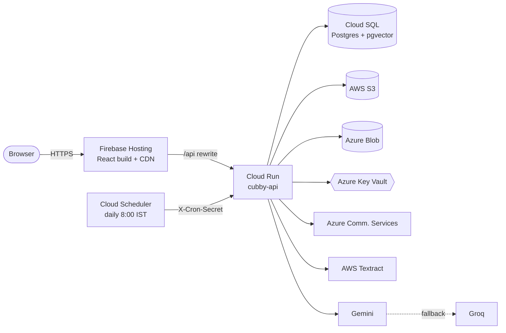

```bash
# Backend → Cloud Run (from the project root)
gcloud run deploy cubby-api --source ./backend --region asia-south1 \
  --allow-unauthenticated \
  --add-cloudsql-instances <PROJECT>:asia-south1:cubby-db \
  --env-vars-file ./backend/env.prod.yaml \
  --no-cpu-throttling --memory 1Gi --max-instances 3

# Frontend → Firebase Hosting
cd frontend && npm run build && firebase deploy --only hosting
```

Then create a Cloud Scheduler job that `POST`s to `https://<your-site>/api/internal/pulse` daily with the header `X-Cron-Secret`. New tables and columns are created automatically when the backend starts. Upgrade notes: [v1.1](docs/UPGRADE_v1.1.md) · [v1.2](docs/UPGRADE_v1.2.md) · [v1.3](docs/UPGRADE_v1.3.md).

<br/>

<details>
<summary><b>🔌 API at a glance</b></summary>

| Area | Routes |
| :--- | :--- |
| Auth | `/api/auth/*`: signup, login, 2FA setup/verify, recovery codes, sessions, password reset |
| Documents | `/api/documents`: upload, list, detail, file, patch, reveal ID, bulk, reprocess, delete |
| Search & chat | `/api/search` · `/api/chat/conversations/{id}/stream` (NDJSON) |
| Studio | `/api/studio/notes` · `/api/studio/reports` · `/api/studio/infographic` |
| Family | `/api/family`: families, invites, messages, share, requests, docs, read receipts |
| Sharing | `/api/documents/{id}/shares` · `/api/public/share/{token}` |
| Vault | `/api/vault/*`: browser-encrypted items only |
| Insights | `/api/insights/*` · `/api/notifications` |
| Trust & admin | `/api/trust/*` (summary, audit, export, delete) · `/api/admin/*` |
| Internal | `/api/internal/pulse` (Cloud Scheduler, secret header) |

Every change request must carry `X-Cubby: 1`, the CSRF guard.
</details>

<br/>

## 🗺️ Roadmap

- [x] Multi-cloud envelope encryption, RAG with citations, ID recognition, Studio, password vault
- [x] **Family vaults** with per-family keys, document requests and `@Cubby` *(v1.3)*
- [ ] **2-of-3 split master key**, with shares in AWS KMS, Azure Key Vault and Google Cloud KMS
- [ ] **Zero-knowledge files**: encrypt in the browser, as the password vault already does
- [ ] **Mobile app** with camera scanning
- [ ] **Passkeys** and **DigiLocker** import
- [ ] Production hardening: Alembic migrations, CI, shared (Redis) rate limits, dark mode

### Known limits

- Rate limits live in each Cloud Run instance's memory, so with 3 instances the real limit can be up to 3× higher.
- Titles, shelves, dates and embedding vectors are stored unencrypted so they can be listed and searched. Passage text, summaries, chats and notes are encrypted.
- Files are decrypted in server memory while being read or answered from.
- Changing `GEMINI_EMBED_MODEL` means reprocessing existing documents.

<br/>

## 📄 License

MIT. See [LICENSE](LICENSE).

<div align="center">
<br/>
<sub>Built with ☕ by <b>Dhruvi Jain</b> · Screenshots use a demo vault with made-up people and numbers.</sub>
</div>
