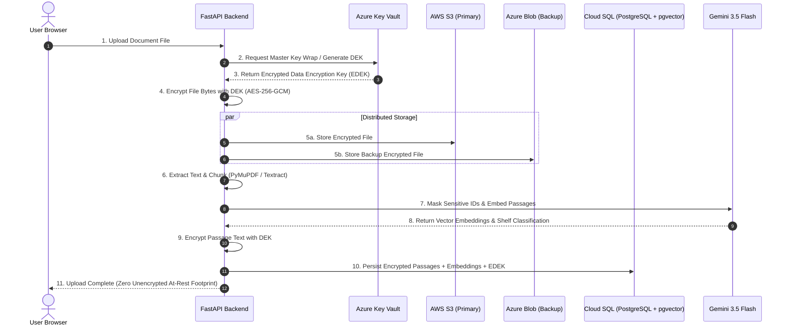
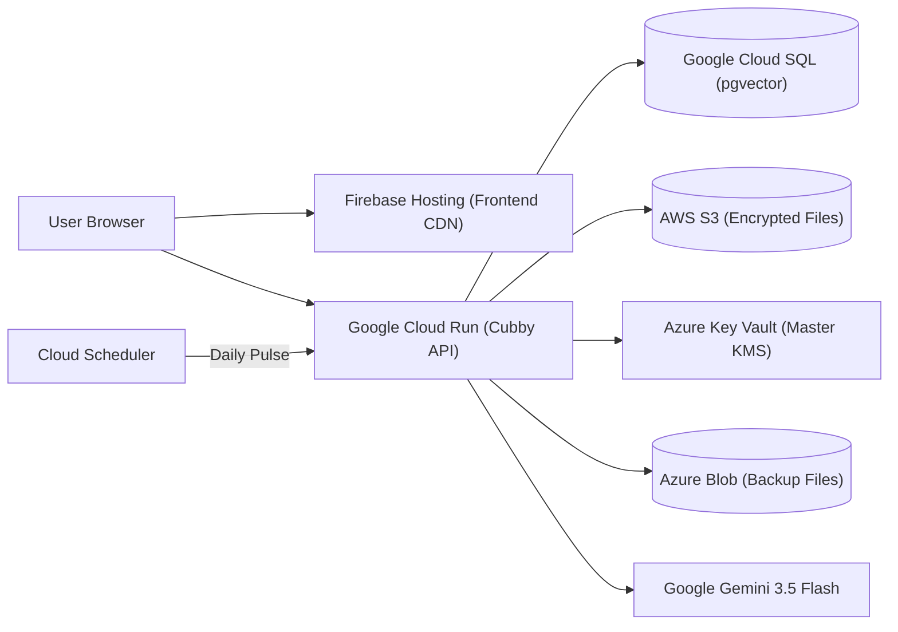

# 🐻 Cubby — Multi-Cloud Personal Data Vault & AI Assistant

[](docs/UPGRADE_v1.3.md)
[](https://fastapi.tiangolo.com/)
[](https://react.dev/)
[](#security-architecture)
[](#multi-cloud-architecture)

> **Store critical personal documents with cryptographic certainty that no single cloud provider ever possesses both your encrypted files and the keys to decrypt them.** Search by semantic meaning, chat with citations that highlight exact passages on source pages, automate expiry alerts, and securely collaborate with your household via encrypted Family Vaults.

---

## 📑 Table of Contents

- [Overview](#overview)
- [Key Features](#-key-features)
  - [Personal Vault & Semantic RAG](#1-personal-vault--semantic-rag)
  - [Family Vaults (New in v1.3)](#2-family-vaults-new-in-v13)
  - [Zero-Knowledge Password Vault](#3-zero-knowledge-password-vault)
  - [ID Shield & Checksum Verification](#4-id-shield--checksum-verification)
  - [Studio & Automated Reporting](#5-studio--automated-reporting)
  - [Enterprise-Grade Security](#6-enterprise-grade-security)
- [Multi-Cloud Architecture](#-multi-cloud-architecture)
  - [Division of Responsibilities](#division-of-responsibilities)
  - [Cryptographic Envelope Encryption Flow](#cryptographic-envelope-encryption-flow)
- [Tech Stack](#-tech-stack)
- [Repository Structure](#-repository-structure)
- [Quick Start (Local Development)](#-quick-start-local-development)
  - [Prerequisites](#prerequisites)
  - [1. Clone & Configure](#1-clone--configure)
  - [2. Start Database & Backend](#2-start-database--backend)
  - [3. Start Frontend](#3-start-frontend)
- [Configuration Reference (.env)](#-configuration-reference-env)
- [Production Deployment](#-production-deployment)
- [Upgrade Guide](#-upgrade-guide)
- [Known Limitations & Roadmap](#-known-limitations--roadmap)
- [License](#-license)

---

## 💡 Overview

Most modern personal cloud storage services hold your raw files and their encryption keys side-by-side. If a single provider suffers a breach, misconfiguration, or legal order, your identity documents, contracts, and financial records are exposed.

**Cubby eliminates single-cloud trust entirely through a distributed zero-knowledge multi-cloud architecture:**
1. **Azure Key Vault** stores your envelope-encrypted master key (KMS).
2. **AWS S3** stores your AES-256-GCM encrypted file blobs; **AWS Textract** extracts text from scans.
3. **Google Cloud** powers AI inference via Gemini (`gemini-3.5-flash`), embeddings (`gemini-embedding-2`), Cloud SQL (`pgvector`), and backend hosting (Cloud Run).
4. **Groq** serves as a redundant, sub-second failover LLM (`gpt-oss-120b`) if Gemini experiences downtime.
5. **Local First**: Every cloud dependency can be seamlessly swapped to local-only mode (`KEY_PROVIDER=local`, `STORAGE_PRIMARY=local`, `EMAIL_PROVIDER=console`) for 100% offline development.

---

## 🌟 Key Features

### 1. Personal Vault & Semantic RAG
- **Deep Semantic Retrieval**: Ask questions in plain English (*"What is my deductible on our medical insurance?"*). Cubby performs vector similarity search across chunked embeddings.
- **Precise Page Citations**: Responses feature interactive source pill badges that jump directly to the target page and highlight the exact source passage in an integrated PDF canvas viewer.
- **Automatic Organization**: Intelligently auto-categorizes uploads into intuitive shelves (Health, Identity, Finance, Property, Taxes, Legal, Education, Vehicle).
- **OCR Engine**: Automatically routes digital PDFs through PyMuPDF and complex scans/images through AWS Textract.
- **Duplicate & Revision Detection**: Flags identical uploads and recognizes document updates.

### 2. Family Vaults *(New in v1.3)*
- **Household Document Chat**: A dedicated collaborative space resembling an encrypted family group chat.
- **Isolated Cryptographic Isolation**: Each family has its own unique AES-256 data key wrapped in Azure Key Vault. Sharing a document creates a distinct family-encrypted copy—leaving your personal vault completely decoupled.
- **Masked ID Protection**: Unmasked government IDs are stripped before entering family storage; only masked representations (e.g., `••••234K`) are visible to household members unless explicitly re-saved.
- **Document Requests**: One-click request cards (e.g., *"Request Birth Certificate from Mom"*). The recipient can fulfill or decline with a single tap.
- **@Cubby Family Assistant**: Mention `@Cubby` inside the family chat to query across all shared family paperwork without exposing anyone's private personal documents.
- **Shared Expiry Deadlines**: Reminds every family member at 90, 30, 7, and 1 days before policies, passports, or warranties expire.

### 3. Zero-Knowledge Password Vault
- **Client-Side Browser Encryption**: Secrets are encrypted and decrypted strictly inside the client's web browser using Web Crypto AES-GCM before transmission.
- **Zero-Knowledge Architecture**: The server only ever persists encrypted ciphertext; plaintext passwords never touch backend memory or logs.
- **Password Generator & Health Audit**: Live entropy scoring, breach detection, duplicate analysis, and password strength auditing.

### 4. ID Shield & Checksum Verification
- **Official Checksum Validation**: Identifies and verifies Passports, Aadhaar, PAN, Voter IDs, and Driving Licences using statutory checksum algorithms (e.g., Verhoeff algorithm).
- **Sensitive Number Masking**: High-entropy ID numbers are obfuscated by default and require a deliberate password confirmation prompt to reveal.
- **AI Privacy Shield**: Automatically sanitizes sensitive identity and tax numbers before passing context to LLMs.

### 5. Studio & Automated Reporting
- **AI Synthesized Reports**: Generate consolidated summaries, timeline overviews, and structured dossiers across multiple documents with verified citations.
- **Exact Data Tables**: Extracts tabular data, policy coverages, and asset lists into queryable spreadsheets.
- **Infographic Generator**: Produces a clean, printable vector infographic summarizing vault statistics, asset distributions, and upcoming renewals.

### 6. Enterprise-Grade Security
- **Mandatory TOTP 2FA**: Required multi-factor authentication with backup single-use emergency recovery codes.
- **Session Protection**: Revocable JWTs stored in `httpOnly`, `SameSite=Lax`, secure `__session` cookies with automated 15-minute inactivity auto-locks.
- **CSRF Defense**: Enforces custom `X-Cubby: 1` header checks across all mutating HTTP verbs (`POST`, `PUT`, `PATCH`, `DELETE`).
- **Cryptographic Password Storage**: Passwords hashed with state-of-the-art Argon2id with unique salts.
- **Administrative Audit Suite**: Role-based Admin Dashboard featuring live cloud health monitoring, startup verification tests, and traceable incident error codes.

---

## ☁️ Multi-Cloud Architecture

### Division of Responsibilities

| Cloud / Service | Technologies & APIs | Role in Cubby |
| :--- | :--- | :--- |
| **AWS** | S3, Textract | Primary encrypted document storage, asynchronous OCR for complex scans & imagery |
| **Azure** | Key Vault, Blob Storage, Communication Services | Master Key KMS envelope wrapping, geo-redundant encrypted backup replica, transactional emails & alerts |
| **Google Cloud** | Cloud Run, Cloud SQL (`pgvector`), Gemini API | Backend container runtime, vector database, Gemini 3.5 Flash semantic Q&A, Gemini Embedding 2 |
| **Groq** | `openai/gpt-oss-120b` | High-speed, low-latency failover LLM triggered automatically if Gemini quotas or outages occur |
| **Firebase** | Firebase Hosting | Global CDN hosting for the compiled React SPA |

### Cryptographic Envelope Encryption Flow



---

## 🛠️ Tech Stack

### Frontend
- **Framework**: [React 18](https://react.dev/) + [Vite 6](https://vitejs.dev/) + [TypeScript](https://www.typescriptlang.org/)
- **Styling**: [Tailwind CSS v4](https://tailwindcss.com/)
- **Animations**: [Framer Motion](https://www.framer.com/motion/)
- **Visualizations**: [Recharts](https://recharts.org/)
- **Icons**: [Lucide React](https://lucide.dev/)
- **Document Viewing**: [PDF.js (`pdfjs-dist`)](https://mozilla.github.io/pdf.js/)
- **Markdown & Math**: `react-markdown`, `remark-gfm`

### Backend
- **Core API**: [FastAPI 0.115+](https://fastapi.tiangolo.com/) with asynchronous lifespan handlers
- **ORM & Database**: [SQLAlchemy 2.0](https://www.sqlalchemy.org/) + [PostgreSQL 16](https://www.postgresql.org/) with [`pgvector`](https://github.com/pgvector/pgvector)
- **Database Driver**: `psycopg` (v3 binary)
- **Data Validation & Settings**: `pydantic-settings`
- **Cryptography & Security**: `cryptography` (AES-256-GCM), `argon2-cffi`, `pyjwt`, `pyotp` (TOTP 2FA)
- **Document Ingestion**: `PyMuPDF` (fitz)
- **Multi-Cloud SDKs**: `boto3`, `azure-keyvault-keys`, `azure-storage-blob`, `azure-communication-email`, `google-genai`

---

## 📂 Repository Structure

```
cubby/
├── backend/
│   ├── app/
│   │   ├── main.py              # FastAPI initialization, CORS, CSRF guard, router mounting
│   │   ├── config.py            # Strictly-typed Pydantic settings loaded from .env
│   │   ├── database.py          # PostgreSQL session factory and schema initialization
│   │   ├── models.py            # SQLAlchemy models (Users, Documents, Passages, Vault, Family)
│   │   ├── security.py          # Argon2 hashing, TOTP secrets, session cookie management
│   │   ├── core/
│   │   │   ├── checks.py        # Startup health and environment validation
│   │   │   ├── errors.py        # Standardized API error responses with audit codes
│   │   │   └── rate_limit.py    # Sliding window IP and account rate limiters
│   │   ├── providers/           # Interchangeable multi-cloud abstractions
│   │   │   ├── keys.py          # Local fallback key generator / Azure Key Vault KMS
│   │   │   ├── storage.py       # Local filesystem / AWS S3 / Azure Blob Storage
│   │   │   ├── ocr.py           # PyMuPDF / AWS Textract pipeline
│   │   │   ├── llm.py           # Gemini 3.5 Flash + Groq fallback LLM handler
│   │   │   └── email.py         # Console logger / Azure Communication Services
│   │   ├── services/            # Domain logic: RAG, ID masking, reminders, encryption
│   │   └── modules/             # Modular API route controllers
│   │       ├── auth.py          # Login, signup, 2FA enrollment, password recovery
│   │       ├── documents.py     # Upload, download, delete, reprocess, metadata
│   │       ├── family.py        # Household vaults, member permissions, document sharing
│   │       ├── search.py        # Hybrid vector + lexical semantic retrieval
│   │       ├── chat.py          # Streaming Q&A with citation links
│   │       ├── vault.py         # Zero-knowledge encrypted password vault
│   │       ├── studio.py        # Dossier compiler, summary tables, infographics
│   │       ├── shares.py        # Time-gated, revocable public viewer URLs
│   │       ├── insights.py      # Automated expiry alerts and scheduled pulse checks
│   │       ├── admin.py         # Administrative telemetry and system status
│   │       └── internal.py      # Authenticated Cron and Cloud Scheduler endpoints
│   ├── scripts/
│   │   └── make_secrets.py      # Cryptographic utility to generate secure app secrets
│   ├── Dockerfile               # Production container image definition
│   ├── requirements.txt         # Pinned Python package dependencies
│   ├── .env.example             # Documented local environment variable template
│   └── env.prod.example.yaml    # Google Cloud Run production environment manifest
├── frontend/
│   ├── src/
│   │   ├── pages/               # Application views (Overview, Family, Vault, Studio, etc.)
│   │   ├── components/          # Reusable UI widgets, PDF viewer, Mascot, Layout
│   │   └── lib/                 # Zero-knowledge crypto, API fetch client, date helpers
│   ├── package.json             # NPM dependencies and scripts
│   ├── vite.config.ts           # Vite bundler configuration
│   └── firebase.json            # Firebase Hosting configuration
├── docker-compose.yml           # Local orchestration for PostgreSQL + pgvector and API
└── docs/
    ├── SETUP_GUIDE.md           # Exhaustive step-by-step tutorial (Parts 0 through 8)
    ├── UPGRADE_v1.1.md          # Migration notes for v1.1
    ├── UPGRADE_v1.2.md          # Migration notes for v1.2
    └── UPGRADE_v1.3.md          # Migration notes for v1.3 (Family Vaults)
```

---

## 🚀 Quick Start (Local Development)

You can run Cubby 100% locally on your workstation without configuring any cloud accounts.

### Prerequisites
- [Docker Desktop](https://www.docker.com/products/docker-desktop/) (running)
- [Node.js 22 LTS](https://nodejs.org/)
- [Python 3.12+](https://www.python.org/downloads/) (with `pip`)

### 1. Clone & Configure

Generate an application secret and prepare your environment:

```bash
# In the backend directory
cd backend
python scripts/make_secrets.py
```

Copy the example environment configuration:
```bash
cp .env.example .env
```

Open `backend/.env` and paste your generated secret into `APP_SECRET` and `LOCAL_MASTER_KEY`:
```ini
APP_ENV=local
APP_SECRET=your_generated_app_secret
KEY_PROVIDER=local
LOCAL_MASTER_KEY=your_generated_master_key
STORAGE_PRIMARY=local
EMAIL_PROVIDER=console
OCR_PROVIDER=none
LLM_PROVIDER=gemini       # Set GCP_PROJECT_ID or switch to local testing
```

### 2. Start Database & Backend

Run Docker Compose from the root project directory:

```bash
# From the project root
docker compose up -d --build
```

Verify backend health by inspecting the container logs:
```bash
docker compose logs -f backend
# Wait for: "Application startup complete."
```

### 3. Start Frontend

In a separate terminal window:

```bash
cd frontend
npm install
npm run dev
```

Visit [http://localhost:5173](http://localhost:5173) in your browser:
1. Create an account.
2. Scan the displayed QR code with your mobile authenticator app (Google Authenticator, Authy, etc.).
3. Save your one-time recovery codes and access your encrypted vault!

---

## ⚙️ Configuration Reference (.env)

| Environment Variable | Allowed Values | Description |
| :--- | :--- | :--- |
| `APP_ENV` | `local`, `production` | Switches security policies, API doc exposure, and CSRF strictness |
| `APP_SECRET` | 64+ char random string | Secret key used for signing session JWT tokens |
| `FRONTEND_ORIGIN` | URL (e.g. `http://localhost:5173`) | CORS allowed origin header |
| `COOKIE_SECURE` | `false` (local), `true` (prod) | Sets the `Secure` flag on the `__session` cookie |
| `CRON_SECRET` | Secret token | Authorizes calls to `/api/internal/pulse` (daily expiry checker) |
| `ADMIN_EMAILS` | Comma-separated emails | Grants elevated access to `/admin` diagnostic dashboard |
| `KEY_PROVIDER` | `local`, `azure` | Source for KMS master key encryption |
| `STORAGE_PRIMARY` | `local`, `s3` | Destination for document ciphertext storage |
| `STORAGE_BACKUP` | `none`, `azure` | Secondary geo-backup storage provider |
| `OCR_PROVIDER` | `none`, `textract` | Document OCR parsing engine |
| `LLM_PROVIDER` | `gemini`, `groq` | Primary RAG and categorization engine |
| `LLM_FALLBACK` | `true`, `false` | Automatically routes to Groq if Gemini returns errors |
| `EMAIL_PROVIDER` | `console`, `acs` | System email delivery service (console logs vs Azure) |

For cloud-connected credentials (`AWS_ACCESS_KEY_ID`, `AZURE_KEY_VAULT_URL`, `GCP_PROJECT_ID`), follow [`docs/SETUP_GUIDE.md`](docs/SETUP_GUIDE.md).

---

## 🌐 Production Deployment

Cubby is designed for modern serverless container hosting:



1. **Deploy Backend to Google Cloud Run**:
   ```bash
   gcloud run deploy cubby-api \
     --source ./backend \
     --region asia-south1 \
     --allow-unauthenticated \
     --add-cloudsql-instances YOUR_PROJECT:REGION:INSTANCE \
     --env-vars-file ./backend/env.prod.yaml \
     --no-cpu-throttling \
     --memory 1Gi \
     --max-instances 3
   ```
2. **Deploy Frontend to Firebase Hosting**:
   ```bash
   cd frontend
   npm run build
   firebase deploy --only hosting
   ```
3. **Configure Daily Expiry Pulse**:
   Create a Google Cloud Scheduler job calling `https://api.yourdomain.com/api/internal/pulse` with the header `X-Cron-Secret: YOUR_CRON_SECRET` once daily.

Detailed step-by-step instructions for production deployment are detailed in [Part 6 of `docs/SETUP_GUIDE.md`](docs/SETUP_GUIDE.md).

---

## 🔄 Upgrade Guide

- **Upgrading to v1.3 (Family Vaults)**: Follow [`docs/UPGRADE_v1.3.md`](docs/UPGRADE_v1.3.md). The backend will automatically apply non-destructive schema updates creating seven new family tables.
- **Upgrading from v1.1 to v1.2**: Follow [`docs/UPGRADE_v1.2.md`](docs/UPGRADE_v1.2.md).
- **Upgrading from v1.0 to v1.1**: Follow [`docs/UPGRADE_v1.1.md`](docs/UPGRADE_v1.1.md).

---

## 🔒 Known Limitations & Roadmap

- **Instance-Level Rate Limits**: In-memory rate limiters operate on a per-container basis rather than through a shared Redis cluster.
- **Metadata Protection**: Document titles, tags, and raw embedding vectors are stored unencrypted in PostgreSQL for index efficiency; passage contents, notes, summaries, and chat transcripts are fully encrypted.
- **Transient Memory Decryption**: Document ciphertext is temporarily decrypted in server RAM during real-time RAG context synthesis.
- **Embedding Model Migrations**: Modifying `GEMINI_EMBED_MODEL` requires re-indexing existing documents using the in-app **Reprocess** tool.

---

## 📄 License

This project is licensed under the MIT License. See [LICENSE](LICENSE) for details.
